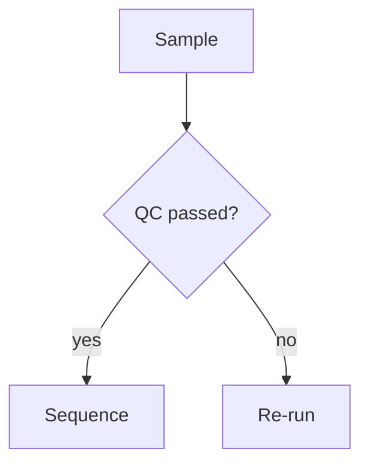

# Obsidian Basics

This note links to [[Project Plan]], to [[Project Plan#Timeline|the timeline]], and to [[folder/Deep Note]].
A link to a heading in this note: [[#Tasks]]. A block reference: [[Project Plan#^decision-1]].

Inline formatting: **bold with a [[Glossary|glossary link]] inside**, *italic*, ==highlighted==, ~~struck~~ and `code [[Not A Link]]`.
%%This comment is hidden.%% Tags: #research #lab/protocols but not #123 or C#.

![[Project Plan#Timeline]]

![[diagram.png|320]]

> [!warning]- Check before running
> - Calibrate the pump
> - Record the **lot number**

> [!tip]
> Plain callout with a link to [[Glossary]].

## Tasks

- [ ] Draft the summary
- [x] Collect samples
- [/] Analysis in progress

## Math and diagrams

Inline math $e^{i\pi} + 1 = 0$ and a price of $5 and $10 that stays text.

$$
\int_0^1 x^2\,dx = \frac{1}{3}
$$



```python
def hello():
    return "world"
```

A footnote reference[^1]. This paragraph has a block id. ^para-1

[^1]: The footnote text with [[Glossary]].
