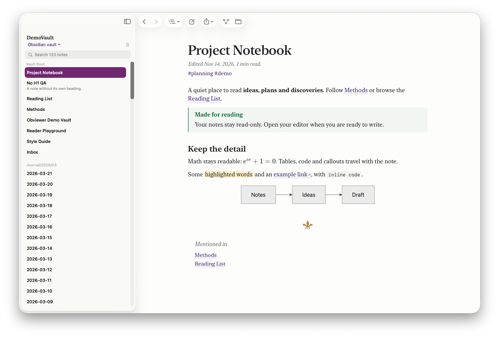

# Obviewer

[](https://github.com/felizvida/obviewer/actions/workflows/ci.yml)

Obviewer is a read-only reader for Markdown and wiki text on the Mac. Double-click a `.md` file and it appears fully rendered: GitHub and Obsidian syntax, note embeds, Mermaid diagrams and math. Open a folder, an Obsidian vault or a DokuWiki to search, follow wiki links, see backlinks and browse a graph. Press Space in Finder for a quick static preview.

Obviewer never changes your notes, and macOS enforces that. To edit, press ⌘E and the note opens in your editor (Sublime Text by default); Obviewer refreshes each time you save. To share, copy the note as rich text or for Slack, print it, or open it as a PDF in Preview.

> **Status:** 0.3.0 is a pre-release. It was verified on one Mac (Apple silicon, macOS 26). See [`docs/STATUS.md`](./docs/STATUS.md) for exactly what has and hasn't been checked, and the known limitations.



*The v0.3.0-beta.2 redesign (captured from a Debug build), reading a synthetic sample note.*

## Install

Follow [`docs/INSTALL.md`](./docs/INSTALL.md). Releases are ad-hoc signed, without an Apple Developer ID, so macOS asks you to approve the app once.

## What it reads

| Source | What you get |
| --- | --- |
| A single `.md` / `.markdown` file | The rendered note, refreshed live when it changes. A banner offers read-only folder access when the note uses images or links stored next to it. |
| A Markdown folder | A searchable library, `[[wiki links]]`, backlinks and a graph |
| An Obsidian vault (contains `.obsidian/`) | Everything above, plus embeds (`![[Note]]`, `#heading`, `^block`), callouts, `==highlights==`, `%%comments%%` and tags |
| A DokuWiki (`data/pages`) | `====== headings ======`, `//italic//`, `[[ns:page]]` links, `{{media}}`, tables and footnotes |

Single files and plain folders open in the Markdown flavor, where Obsidian-only syntax (`==highlights==`, `%%comments%%`, `#tags`) stays as written; switch the badge to Obsidian to render it. Every Markdown flavor gets CommonMark and GitHub Flavored Markdown: tables, task lists, strikethrough, autolinks, footnotes and `> [!NOTE]` alerts. It also gets `$math$` via KaTeX, Mermaid diagrams and highlighted code. The flavor is detected automatically and shown as a badge you can change.

## Safety

- **Your notes are read-only, enforced by macOS.** The app is sandboxed and its only file permission is read-only access to what you choose. It writes only to its own container and the clipboard.
- **Note content is contained.** HTML in notes is sanitized, scripts can't run, and the reader loads only bundled files and files from your folder.
- **Network.** WebKit, which draws the notes, needs the "outgoing network" permission to start inside the sandbox, so the app holds it. Obviewer itself makes no network requests, and the reader blocks remote loads. That blocking is enforced by the app, not by macOS. The Quick Look extension has no network permission.
- **Handing off is explicit.** Editors, Preview and share services you choose run outside the sandbox. Obviewer asks before opening attachments or app links, and never opens apps or scripts from a note.

Details and enforcement points: [`docs/READER_ARCHITECTURE.md`](./docs/READER_ARCHITECTURE.md).

## Build from source

You need macOS 14 or later, Xcode 15 or later, and XcodeGen (`brew install xcodegen`). Node 20 or later is only needed to change the renderer. [`QUICKSTART.md`](./QUICKSTART.md) has the short version; [`docs/DEVELOPMENT.md`](./docs/DEVELOPMENT.md) has the full workflow.

```bash
make try-local          # check Xcode, install XcodeGen if needed, generate and open the project
swift test              # Swift tests
make renderer-test      # renderer tests (after `cd Renderer && npm ci --ignore-scripts`)
make package-adhoc      # ad-hoc signed DMG
```

## Documentation

- [`docs/README.md`](./docs/README.md): index and reading order
- [`docs/STATUS.md`](./docs/STATUS.md): what's verified, what's limited, what's unverified
- [`docs/ARCHITECTURE.md`](./docs/ARCHITECTURE.md) and [`docs/READER_ARCHITECTURE.md`](./docs/READER_ARCHITECTURE.md): how it works
- [`CHANGELOG.md`](./CHANGELOG.md): release history

## License

Apache 2.0. Third-party software bundled in the reader (markdown-it, Mermaid, KaTeX, highlight.js, DOMPurify and their dependencies) is listed with its licenses in `Sources/ObviewerReaderKit/Resources/Reader/THIRD_PARTY_NOTICES.txt`.
